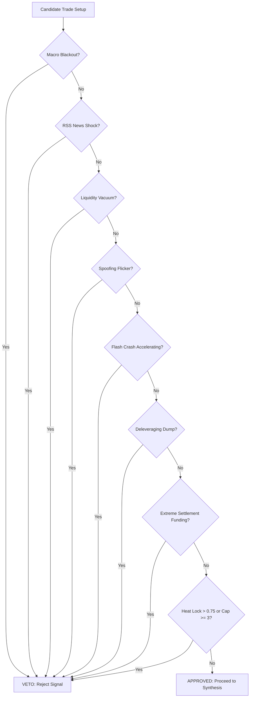

# ⚡ Institutional Crypto Futures Microstructure Signal Bot

> **Zero-Cost, Zero-Lag, Read-Only Order Flow Alpha Engine for Binance Futures**  
> *Built with Pure Python Standard Library, Asyncio, and Bayesian Probability (No Pandas, No NumPy, <150MB RAM)*

[](https://www.python.org/downloads/)
[](https://opensource.org/licenses/MIT)
[]()
[]()

---

## 📖 Shuru Korar Age (A Note to the Learner)

Ei project-ti banano hoyeche tader jonno jara crypto futures market-er **actual mechanics** shikhte chay. Tumi jodi YouTube-er RSI, MACD ba Bollinger Bands dekhe frustrate hoye thako, tahole tumi thik jaygay eshecho. 

Ekhane kono paid API, kono trade execution risk, ba kono black-box machine learning nei. Shob kichu transparent, mathematical, ebong **pure microstructure physics**-er upor base kore toiri.

---

## 📑 Table of Contents

1. [Philosophy: Keno Order Flow? Keno RSI/MACD Na?](#1-philosophy-keno-order-flow-keno-rsimacd-na)
2. [Repository Structure (Folder & File Overview)](#2-repository-structure-folder--file-overview)
3. [The 5 Phases Journey](#3-the-5-phases-journey)
4. [The 6 "Hedge Fund" Edges (In-Depth Explanation)](#4-the-6-hedge-fund-edges-in-depth-explanation)
5. [The Veto Matrix (Jokhon Bot Trade Korte Mana Kore)](#5-the-veto-matrix-jokhon-bot-trade-korte-mana-kore)
6. [Signal Synthesis & Dynamic Risk Sizing](#6-signal-synthesis--dynamic-risk-sizing)
7. [Telegram Signal Format (Visual Breakdown)](#7-telegram-signal-format-visual-breakdown)
8. [VPS Deployment Guide (1GB RAM Ubuntu Setup)](#8-vps-deployment-guide-1gb-ram-ubuntu-setup)
9. [Documentation Index](#9-documentation-index)

---

## 1. Philosophy: Keno Order Flow? Keno RSI/MACD Na?

### Traditional Retail Indicators-er Oshubidha:
Retail trader-ra chart-er candle close howar por RSI ba Supertrend dekhe. Kintu shob traditional technical indicator holo **Lagging** — mane price age ghote jay, tarpor indicator update hoy. 

Price keno move kore? Price kono mathematical formula dekhe move kore na! 
Price move kore jokhon:
> **Aggressive Market Orders (Takers)** order book-er shob **Limit Orders (Makers)**-ke gile fele price-ke push kore!

```mermaid
flowchart LR
    Orders["Aggressive Market Orders (CVD / Takers)"] -->|Clash With| Book["Order Book Limit Depth (OFI / Makers)"]
    Book -->|Liquidity Exhaustion| Price["Price Movement (Tick Level)"]
    Price -->|Candle Close (Lag)| RSI["Retail Indicators (RSI / MACD / EMA)"]
```

### Amader Solution:
Amra chart-er laggy candle-er jonno wait kori na. Amra **tick-by-tick order book** scan kori:
- Limit orders kotota joma hochhe? (Order Flow Imbalance)
- Aggressive seller-ra sell korleo price keno porche na? (Absorption)
- Over-leveraged trader-ra kothay liquidate hochhe? (Cascade Exhaustion)
- Bitcoin breakdown korleo Ethereum keno hold korche? (Cross-Asset SMT)

Etai holo institutional quantitative hedge fund-der trading poddhoti.

---

## 2. Repository Structure (Folder & File Overview)

Prottek file ebong folder-er uddessho niche shohoj bhashay deoya holo:

```
ARUN-THE-BEST-STUDENT-OF-MARKET/
├── .env.example                ← Environment variables template (Telegram credentials)
├── AGENTS.md                   ← Project rules: Zero pandas, slots everywhere, no paid APIs
├── config.py                   ← Global settings: symbols (BTC, ETH, SOL), window sizes, URLs
├── main.py                     ← Complete production orchestrator (All phases unified)
├── requirements.txt            ← Minimalist dependencies (uvloop, websockets, aiohttp, orjson)
│
├── core/
│   ├── __init__.py
│   └── state.py                ← SymbolMicroState (memory-efficient state) & Welford OnlineNormalizer
│
├── ingestion/
│   ├── __init__.py
│   └── ws_manager.py           ← Dual-WebSocket manager (Public & Market streams with back-off)
│
├── engine/
│   ├── __init__.py
│   ├── microstructure.py       ← Phase 2: L5 OFI, Micro-Price, CVD Absorption, Z_liq
│   ├── cross_asset.py          ← Phase 3: SMT Detector (BTC/ETH/SOL structural divergence)
│   ├── derivatives.py          ← Phase 3: Short Squeeze & Long Trap regime classifier
│   ├── rest_engine.py          ← Phase 3: Lazy REST confirmation (OI delta, Basis, Funding)
│   ├── news_engine.py          ← Phase 4: ForexFactory calendar blackout & RSS headline scanner
│   ├── heat_lock.py            ← Phase 4: Rolling 60m correlation heat lock matrix
│   ├── vetoes.py               ← Comprehensive Veto Matrix (all 8 institutional veto guards)
│   ├── synthesis.py            ← Phase 5: Bayesian log-odds scorer & sigmoid probability
│   └── risk.py                 ← Phase 5: Volatility Stop Loss, multi-tier TP, and Kelly sizing
│
├── dispatch/
│   ├── __init__.py
│   └── telegram_bot.py         ← Phase 5: Async token-bucket queue worker & 429 retry back-off
│
├── docs/                       ← Deep-dive architectural guides for each Phase
│   ├── phase1_ingestion_memory.md
│   ├── phase2_microstructure_alpha.md
│   ├── phase3_rest_regimes.md
│   ├── phase4_macro_vetoes.md
│   └── phase5_synthesis_telegram.md
│
└── tests/                      ← 272 passing pytest unit tests
    ├── test_config.py
    ├── test_cross_asset.py
    ├── test_derivatives.py
    ├── test_heat_lock.py
    ├── test_microstructure.py
    ├── test_news_engine.py
    ├── test_rest_engine.py
    ├── test_risk.py
    ├── test_state.py
    ├── test_synthesis.py
    ├── test_telegram_bot.py
    ├── test_vetoes.py
    └── test_ws_manager.py
```

---

## 3. The 5 Phases Journey

| Phase | Name | Main Deliverables | Memory / Performance Focus |
| :--- | :--- | :--- | :--- |
| **Phase 1** | **Zero-Cost Ingestion & Memory Core** | Dual-WebSocket connections, `orjson` raw byte parsing, Welford's streaming algorithm, `SymbolMicroState`. | Zero string allocations, bounded deques, `__slots__` everywhere. |
| **Phase 2** | **Microstructure Alpha Engine** | Multi-level L5 OFI with exponential decay, Volume-Weighted Micro-Price, CVD Absorption, $Z_{\text{liq}}$ liquidation exhaustion. | C-double typed arrays (`array('d')`), pre-computed weight tuples, 256-byte message routing. |
| **Phase 3** | **Lazy REST Confirmation & Regimes** | Open Interest $\Delta OI\%$, Spot-Perp Basis bps, Cross-Asset SMT Detector, Short Squeeze / Long Trap classifier. | 180s TTL caching, `X-MBX-USED-WEIGHT-1M` rate limit defense (<1800 limit). |
| **Phase 4** | **Macro News & Institutional Vetoes** | ForexFactory calendar blackout ($\pm 15\text{m}$), RSS headline shock scanner (45m blackout), Correlation Heat Lock, Liquidity Vacuum veto. | Built-in `xml.etree.ElementTree` with `root.clear()`, zero heavy NLP dependencies. |
| **Phase 5** | **Synthesis, Risk & Telegram Dispatch** | Bayesian Log-Odds scorer ($P \ge 0.820$), Volatility-buffered SL/TP, Fractional Kelly sizing ($f^* \le 1.25\%$), Async Telegram queue. | Token-bucket rate limiter, HTML parse mode, HTTP 429 retry back-off, full `main.py` orchestrator. |

---

## 4. The 6 "Hedge Fund" Edges (In-Depth Explanation)

Amader system 6 ti independent quantitative edges-ke eksathe combine kore:

### 1. Multi-Level Order Flow Imbalance (L5 OFI) — Weight: `0.28`
- **Kon bhabe bojha jay:** Order book holo buyers ebong sellers-der yuddher mohtad. Prottek 100ms-e amra top 5 levels scan kori.
- **Math:** Exponential depth decay weight $w_i = e^{-0.35 \cdot (i-1)}$. Level 1-e 100% weight, Level 5-e ~24% weight.
- **Intuition:** Ask-e jodi order cancel hoy ebong Bid-e notun order joma hoy, OFI boro positive number hoy $\rightarrow$ Aggressive buying pressure!

### 2. Cumulative Volume Delta (CVD) Absorption — Weight: `0.22`
- **Kon bhabe bojha jay:** Whales-ra kokhono chart dekhe market buy kore na; tara limit order boshiye rakhe.
- **Math:** 15-minute rolling linear regression slope divergence:
  $$\text{Score} = \left(\frac{\text{slope}_{\text{CVD}}}{\text{std}_{\text{CVD}}}\right) - \left(\frac{\text{slope}_{\text{Price}}}{\text{std}_{\text{Price}}}\right)$$
- **Intuition:** Price drop korche kintu CVD slope sthir ba positive? Tar mane institutional buyers-ra shob sell volume niche limit order diye absorb kore niche!

### 3. Liquidation Cascade Exhaustion ($Z_{\text{liq}}$) — Weight: `0.20`
- **Kon bhabe bojha jay:** Retailers-ra jokhon panic-e liquidate hoy, tokhon forced market orders market-e flood toiri kore.
- **Math:** 60-second rolling liquidation volume-ke 15-minute Welford baseline-er sathe compare kore Z-score ber kora hoy.
- **Intuition:** Jokhon $Z_{\text{liq}} \ge 3.0$ hoy, tar mane capitulation shobashobi shesh! Erpor chhotto ekta buying pressure-i boro short squeeze ghotate pare.

### 4. Open Interest & Basis Skew — Weight: `0.14`
- **Kon bhabe bojha jay:** Market-e notun money enter korche naki exit korche?
- **Math:** 15-minute Open Interest delta $\Delta OI\%$ ebong Spot-Perp Basis in bps.
- **Intuition:** Price flat ba niche namche kintu OI druto barche ($\Delta OI > 1.5\%$) ebong Basis negative? Eita clear **Short Squeeze Setup**!

### 5. Cross-Asset Smart Money Divergence (SMT) — Weight: `0.10`
- **Kon bhabe bojha jay:** Correlated asset-der moddhe institutional preference.
- **Math:** Bitcoin swing low bhenge break korlo ($P_A < L_A$), kintu Ethereum shokto bhabe swing low-er upore hold korlo ($P_B > L_B$).
  $$\text{SMT} = \left(\frac{P_{\text{ETH}} - L_{\text{ETH}}}{\text{ATR}_{\text{ETH}}}\right) - \left(\frac{P_{\text{BTC}} - L_{\text{BTC}}}{\text{ATR}_{\text{BTC}}}\right)$$
- **Intuition:** Jokhon $\text{SMT} \ge 0.35$ hoy, tar mane Ethereum-e institutional buying dominance promanito!

### 6. Volume-Weighted Micro-Price Displacement — Weight: `0.06`
- **Kon bhabe bojha jay:** Top-of-book quantity asymmetry.
- **Math:** $P_{\text{micro}} = \frac{P_{\text{bid}} \cdot Q_{\text{ask}} + P_{\text{ask}} \cdot Q_{\text{bid}}}{Q_{\text{ask}} + Q_{\text{bid}}}$.
- **Intuition:** Bid-e jodi huge quantity stacking thake, micro-price ask-er dike shift hoye jay, ja immediate next tick-er direction indicate kore.

---

## 5. The Veto Matrix (Jokhon Bot Trade Korte Mana Kore)

Profit korar cheyeo account bachano beshi gorutto. Ekhane 8 ta institutional veto ache — **er moddhe ektao jodi trigger hoy, bot kono trade nebe na!**



1. **Macro Calendar Blackout (`MacroAndNewsVetoEngine`):** High-impact US news (CPI, FOMC, NFP) er $\pm 15$ minutes-er moddhe shob trade bondho.
2. **RSS Headline Shock Scanner (`MacroAndNewsVetoEngine`):** CoinDesk ba Cointelegraph-e `hack`, `exploited`, `insolvency`, `sec sues`, ba `depeg` paoa gele 45 minutes blackout.
3. **Liquidity Vacuum Veto (`LiquidityVacuumVeto`):** Spread $> 3.5\text{ bps}$ hole ba top-5 book depth $1.5\sigma$ drop korle trade veto.
4. **Spoofing Quote-Flicker Veto (`SpoofingQuoteFlickerVeto`):** OFI anomaly-ke minimum 500ms persist korte hobe ebong realized taker flow (CVD) diye corroborate hote hobe.
5. **Flash-Crash Knife-Catch Veto (`FlashCrashKnifeCatchVeto`):** Joto khon liquidation velocity barche, counter-trend long dhora prohibited. Peak theke $> 60\%$ decelerate hole tokhon unlock hoy.
6. **Deleveraging Veto (`DeleveragingVeto`):** 15m price drop sathe contracting OI ($\Delta OI < -2.5\%$) ebong neutral funding hole long veto (unless $Z_{\text{liq}} > 3.5$).
7. **Funding Settlement Boundary Veto (`FundingSettlementBoundaryVeto`):** Settlement-er $\pm 5$ minutes-er moddhe extreme funding payer trade veto.
8. **Correlation Heat Lock Veto (`CorrelationHeatLock`):** Max 3 concurrent active trades; candidate trade-er correlation kono active trade-er sathe $> 0.75$ hole veto.

---

## 6. Signal Synthesis & Dynamic Risk Sizing

### A. Bayesian Log-Odds Scoring
Shob edge Z-scores eksathe linear log-odds toiri kore:
$$L_t = -1.5 + 0.28 z_{\text{ofi}} + 0.22 z_{\text{cvd}} + 0.20 z_{\text{liq}} + 0.14 z_{\text{oi}} + 0.10 z_{\text{smt}} + 0.06 z_{\text{micro}}$$
$$P(\text{Win}) = \frac{1}{1 + e^{-L_t}}$$

**Triple-Check Validity:**
1. $P(\text{Win}) \ge 0.820$ (82% probability)
2. $\ge 3$ edges activated above threshold
3. 0 vetoes active

### B. Volatility-Adjusted Stop Loss & Take Profits
Market maker stop hunt protect korar jonno ATR buffer:
- **LONG SL:** $\min(P_{\text{sweep}}, P_{\text{entry}} - 1.5 \times \text{ATR}_{14}) - 0.35 \times \text{ATR}_{14}$
- **SHORT SL:** $\max(P_{\text{sweep}}, P_{\text{entry}} + 1.5 \times \text{ATR}_{14}) + 0.35 \times \text{ATR}_{14}$
- **Take Profits ($R = |P_{\text{entry}} - \text{SL}|$):**
  - **TP1 (40% scale-out):** $\text{Entry} \pm 1.5R$
  - **TP2 (40% scale-out):** $\text{Entry} \pm 2.8R$
  - **TP3 (20% runner):** $\text{Entry} \pm 4.5R$

### C. Fractional Kelly Criterion Position Sizing
$$f^* = \min\left(0.0125, 0.25 \times \left(p - \frac{1 - p}{2.45}\right)\right)$$
Portfolio-te kokhono **$1.25\%$** er beshi risk neoya hoy na.

---

## 7. Telegram Signal Format (Visual Breakdown)

Jokhon shob condition satisfy hoy, Telegram-e instant HTML message deliver hoy:

```html
⚡ MICROSTRUCTURE ALPHA SIGNAL ⚡

Asset: #BTCUSDT
Direction: 🟢 LONG
Bayesian P(Win): 86.5%

Entry Price: $64,250.00
Stop Loss: $63,910.00 (Risk: $340.00)

Targets:
• TP1 (40%): $64,760.00 (+1.5R)
• TP2 (40%): $65,202.00 (+2.8R)
• TP3 (20%): $65,780.00 (+4.5R)

Kelly Position Sizing: 1.25%

Active Microstructure Edges:
• L5 OFI: +2.85
• CVD Absorption: +2.30
• Liq Exhaustion: +3.42
• OI & Basis: +1.95
• SMT Divergence: +1.88
• Micro-Price: +1.60
```

### Explanation:
- **`Asset` & `Direction`:** Kon pair-e kon dike trade (🟢 LONG ba 🔴 SHORT).
- **`Bayesian P(Win)`:** Composite edge score theke calculated statistical win probability.
- **`Entry` & `Stop Loss`:** Market entry mid-price ebong volatility-buffered protective stop.
- **`Targets (TP1, TP2, TP3)`:** Multi-tier partial scale-outs ($40\%$, $40\%$, $20\%$).
- **`Kelly Position Sizing`:** Recommended portfolio risk percentage ($f^* \le 1.25\%$).
- **`Active Microstructure Edges`:** Kon kon edge trigger koreche tar exact Z-scores.

---

## 8. VPS Deployment Guide (1GB RAM Ubuntu Setup)

Ei bot-ti ekta standard **$4-$5/month Linux VPS-e (1GB RAM, 1 vCPU)** cholte pare.

### Step 1: Clone Repository & Virtualenv
```bash
# Clone repository
git clone https://github.com/arunabhamaity148-cell/ARUN-THE-BEST-STUDENT-OF-MARKET.git
cd ARUN-THE-BEST-STUDENT-OF-MARKET

# Create virtual environment
python3 -m venv venv
source venv/bin/activate

# Install dependencies (ultra-lightweight)
pip install -r requirements.txt
```

### Step 2: Configure Environment Variables
```bash
cp .env.example .env
nano .env
```
Inside `.env`:
```ini
TELEGRAM_BOT_TOKEN=123456789:ABCdefGhIJKlmNoPQRsTUVwxyZ
TELEGRAM_CHAT_ID=-1001234567890
```

### Step 3: Verify All Unit Tests
```bash
python -m pytest -v
# Output should show: 272 passed in ~2.5s
```

### Step 4: Setup `systemd` Service for 24/7 Autostart
Service file toiri korun:
```bash
sudo nano /etc/systemd/system/crypto-signal-bot.service
```
Paste this configuration:
```ini
[Unit]
Description=Institutional Crypto Futures Microstructure Signal Bot
After=network.target

[Service]
Type=simple
User=ubuntu
WorkingDirectory=/home/ubuntu/ARUN-THE-BEST-STUDENT-OF-MARKET
EnvironmentFile=/home/ubuntu/ARUN-THE-BEST-STUDENT-OF-MARKET/.env
ExecStart=/home/ubuntu/ARUN-THE-BEST-STUDENT-OF-MARKET/venv/bin/python main.py
Restart=always
RestartSec=5
MemoryMax=250M

[Install]
WantedBy=multi-user.target
```

### Step 5: Start & Monitor the Bot
```bash
# Reload systemd
sudo systemctl daemon-reload

# Enable service on reboot
sudo systemctl enable crypto-signal-bot

# Start service
sudo systemctl start crypto-signal-bot

# Check live logs in real-time
journalctl -u crypto-signal-bot -f

# Check status & memory usage
sudo systemctl status crypto-signal-bot
```

---

## 9. Documentation Index

Prottek Phase-er deep-dive architecture ebong mathematical derivation dekhte niche links click korun:

- 📘 [Phase 1: Zero-Cost Ingestion & Memory Core](docs/phase1_ingestion_memory.md)
- ⚡ [Phase 2: Microstructure Alpha Engine](docs/phase2_microstructure_alpha.md)
- 🌐 [Phase 3: Lazy REST Confirmation & Cross-Asset Regimes](docs/phase3_rest_regimes.md)
- 🛑 [Phase 4: Macro News & Institutional Veto Matrix](docs/phase4_macro_vetoes.md)
- 🎯 [Phase 5: Signal Synthesis, Risk Sizing, & Telegram Dispatch](docs/phase5_synthesis_telegram.md)

---

## ⚖️ Disclaimer

Ei software-ti shudhumatro **educational ebong quantitative research purpose**-e toiri kora hoyeche. Eita kono direct trade execution kore na (purely read-only signals). Crypto futures trading-e boro financial risk thake; nijer risk management ebong discipline chara kono trading kora uchit noy.
