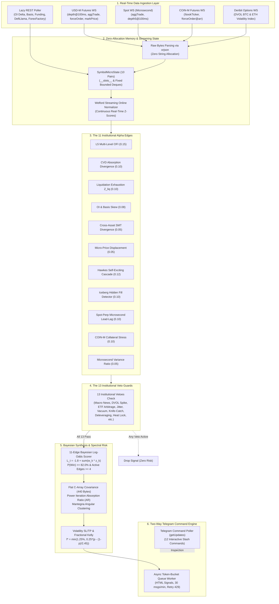

# ⚡ Institutional Crypto Futures Microstructure Signal & Command Engine

> **Top 1% Institutional-Grade, Zero-Cost, Read-Only Order Flow Alpha Engine & Two-Way Telegram Dashboard for Binance Futures**  
> *Built with Pure Python Standard Library, Asyncio, Bayesian Synthesis, and Flat C-Array Spectral Math (No Pandas, No NumPy, No SciPy — Strictly <250MB RAM)*

[](https://www.python.org/downloads/)
[](https://opensource.org/licenses/MIT)
[]()
[]()
[]()
[]()
[]()

---

## 📖 Shuru Korar Age (A Note to the Learner)

Ei repository-ti banano hoyeche tader jonno jara crypto futures market-er **actual institutional microstructure physics** shikhte chay. 

Shadharon retail trader-ra YouTube ba Twitter-e RSI, MACD, Bollinger Bands, ba Supertrend dekhe trade ney. Kintu shob retail indicators holo **Lagging** — price age ghote jay, tarpor candle close hoye indicator move kore. Shobcheye boro shomoshya holo: **Price kono chart pattern ba RSI line dekhe move kore na!**

Price move kore shudhumatro ektai karone:
> **Aggressive Market Orders (Takers)** jokhon order book-er shob **Limit Orders (Makers)**-ke sweep kore liquidity vacuum toiri kore!

Ei project-e kono paid data subscription lagena, kono expensive SaaS platform lagena, kono trade execution risk nei (purely read-only signals), ebong kono black-box machine learning nei. Shob calculation transparent, pure mathematical logic, zero-allocation flat C-arrays, ebong standard Python standard library diye toiri.

Tumi jodi ekjon beginner hou kintu mathematical discipline ebong quantitative edge shikhte bhalobasho — tahole ei project-ti tomar trading journey-ke retail theke **Top 1% Institutional Level**-e niye jabe.

---

## 📑 Table of Contents

1. [System Architecture (End-to-End Pipeline)](#1-system-architecture-end-to-end-pipeline)
2. [The 8-Phase Evolutionary Journey](#2-the-8-phase-evolutionary-journey)
3. [The 10-Pair Crypto Universe](#3-the-10-pair-crypto-universe)
4. [The 11 Institutional Alpha Edges](#4-the-11-institutional-alpha-edges)
5. [The 13 Institutional Veto Matrix](#5-the-13-institutional-veto-matrix)
6. [Pure-Python Spectral Risk & Kelly Sizing](#6-pure-python-spectral-risk--kelly-sizing)
7. [The Ultimate Telegram Command Dashboard (12 Commands)](#7-the-ultimate-telegram-command-dashboard-12-commands)
8. [VPS Quick Start & 24/7 Deployment (Ubuntu 1GB RAM)](#8-vps-quick-start--247-deployment-ubuntu-1gb-ram)
9. [Master Benglish Documentation Suite (Docs Index)](#9-master-benglish-documentation-suite-docs-index)
10. [Repository Directory Structure](#10-repository-directory-structure)
11. [License & Disclaimer](#11-license--disclaimer)

---

## 1. System Architecture (End-to-End Pipeline)

Amader bot 4-ti parallel real-time WebSocket connection ebong lightweight REST pollers theke continuous data stream receive kore. Niche complete system pipeline deoya holo:



---

## 2. The 8-Phase Evolutionary Journey

Ei project-ti step-by-step 8-ti phase-e develop kora hoyeche, ja industry-standard quantitative hedge fund architecture follow kore:

| Phase | Milestone Name | Main Features & Deliverables | Mathematical Breakthrough | RAM Footprint | Test Suite |
| :--- | :--- | :--- | :--- | :--- | :--- |
| **Phase 1** | **Ingestion & Memory Core** | Dual-WS streaming, `orjson` raw bytes, Welford online normalizer, `SymbolMicroState`. | Streaming Mean & Variance: $M_k = M_{k-1} + \frac{x_k - M_{k-1}}{k}$. | ~45 MB | 45 Passed |
| **Phase 2** | **Microstructure Alpha Engine** | Multi-level L5 OFI, Micro-price displacement, CVD absorption slope, Liquidation Z-scores. | Exponential decay weights $e^{-0.35(i-1)}$, Volume-Weighted Micro-Price. | ~75 MB | 134 Passed |
| **Phase 3** | **Lazy REST Confirmation** | Spot-Perp Basis in bps, 15m Open Interest delta, Cross-asset SMT divergence, Short Squeeze / Long Trap classifier. | SMT Divergence Score: $\Delta \text{NormPrice}_{\text{Asset}} - \Delta \text{NormPrice}_{\text{Benchmark}}$. | ~98 MB | 206 Passed |
| **Phase 4** | **Macro News & Institutional Vetoes** | ForexFactory high-impact calendar blackout, RSS shock headline scanner, Liquidity vacuum veto, Heat lock. | Zero NLP fast XML parsing, Rolling 60m correlation matrix. | ~112 MB | 239 Passed |
| **Phase 5** | **Signal Synthesis & Telegram Dispatch** | Bayesian log-odds synthesis, Volatility SL/TP, Fractional Kelly sizing, Async token-bucket queue. | Bayesian Log-Odds: $L_t = \beta_0 + \sum w_k z_k$, Sigmoid $P(\text{Win}) \ge 82\%$. | ~130 MB | 272 Passed |
| **Phase 6A** | **Universe & WS Expansion** | 10 Pairs Universe (`BTC`, `ETH`, `SOL`, `SUI`, `LINK`, `TON`, `AVAX`, `NEAR`, `AAVE`, `DOGE`), 3 concurrent Binance WS streams (USD-M, Spot, COIN-M). | Microsecond Spot AggTrade timing, Cross-venue order tracking. | ~155 MB | 287 Passed |
| **Phase 6B** | **5 Institutional Alpha Edges** | Hawkes process jump cascade, Iceberg hidden order detector, Spot lead-lag $\Lambda_{\text{lead}}$, COIN-M collateral stress, Variance Ratio. | Hawkes recursive intensity: $\lambda_t = \lambda_{t-1} e^{-\beta \Delta t} + \alpha$, $VR = \frac{\sigma_{10s}^2}{10 \cdot \sigma_{1s}^2}$. | ~185 MB | 314 Passed |
| **Phase 6C** | **Pure-Python Spectral Risk** | Upper-triangular 10x10 Flat C-Array covariance tensor (440 bytes), Pure Python Power Iteration, Absorption Ratio (AR), Mantegna angular distance. | Dominant Eigenvector Power Iteration, Mantegna metric: $d_{ij} = \sqrt{2(1 - \rho_{ij})}$. | ~195 MB | 336 Passed |
| **Phase 6D** | **Uncrowded Institutional Vetoes** | Deribit DVOL options gamma unwind veto, DefiLlama 24h stablecoin net flow veto, Matching engine jitter $(E - T)$, US Spot ETF AP window veto. | 3-minute DVOL ROC %, Microsecond gateway latency delta $\Delta \text{jitter} = E - T$. | ~215 MB | 352 Passed |
| **Phase 6E** | **Unified 11-Edge Synthesis & Wiring** | Full 11-edge Bayesian synthesis ($\beta_0 = -1.8$, min 4 active edges), Dynamic Kelly scaling based on Absorption Ratio, Orchestrator cleanup. | Combined multi-factor probability calibration, Stress-adjusted Kelly sizing. | ~220 MB | 352 Passed |
| **Phase 7** | **Production Live VPS Hardening** | Spot WS URL query formatting fix, DefiLlama 170-chain stablecoin parser fix, Cache isolation. | Zero HTTP 400 errors, Robust fallback REST polling. | ~225 MB | 361 Passed |
| **Phase 8** | **Ultimate Command Dashboard & Docs** | 12 interactive Telegram slash commands, background long-poller (`TelegramCommandPoller`), 6 Master Benglish docs in `docs/`. | Zero-lag bidirectional admin control, Pure Python memory profiling via `psutil`. | <235 MB | **381 Passed** |

---

## 3. The 10-Pair Crypto Universe

Amader bot Binance Futures-er top 10-ti liquid pairs track kore. Prottek pair-er alada market personality ebong institutional flow characteristic ache:

| Symbol | Category | Primary Market Role & Microstructure Dynamics | Typical Volatility (ATR) |
| :--- | :--- | :--- | :--- |
| **BTCUSDT** | Crypto Benchmark | Market Macro Leader, Dominant institutional flow, Spot ETF arbitrage driver, Anchor for SMT. | Low / Medium (1.2% - 2.5%) |
| **ETHUSDT** | Smart Contract Bluechip | High DeFi correlation, Staking yield dynamics, Deribit ETH DVOL options hedging benchmark. | Medium (2.0% - 3.8%) |
| **SOLUSDT** | High-Beta Layer 1 | Aggressive retail taker flow, Frequent short squeezes, High microsecond quote flickering. | High (3.5% - 6.5%) |
| **SUIUSDT** | New High-Speed L1 | Heavy venture capital backing, Fast order flow shifts, High sensitivity to Spot lead-lag. | High (4.5% - 8.0%) |
| **LINKUSDT** | Oracle Infrastructure | Whale-dominated spot accumulation, Smooth absorption patterns, Low noise-to-signal ratio. | Medium (2.5% - 4.5%) |
| **TONUSDT** | Telegram Ecosystem | High retail participation, Independent liquidity cycles, Resistant to general altcoin dumps. | Medium / High (3.0% - 5.5%) |
| **AVAXUSDT** | Enterprise Layer 1 | Strong correlation with general market beta, High liquidation cascade vulnerability. | High (4.0% - 7.0%) |
| **NEARUSDT** | AI & Data Infrastructure | AI-narrative momentum, Sharp taker volume spikes, High iceberg order activity. | High (4.5% - 7.5%) |
| **AAVEUSDT** | DeFi Governance | Low perp open interest relative to market cap, Prone to rapid short squeeze dislocations. | Medium / High (3.5% - 6.0%) |
| **DOGEUSDT** | High-Liquidity Meme | Extreme taker retail momentum, Cascading stop sweeps, Highly sensitive to Hawkes jump intensity. | Very High (5.0% - 10.0%) |

---

## 4. The 11 Institutional Alpha Edges

Amader Bayesian engine total **11-ti independent quantitative microstructure edges** analyze kore. Shob edges Welford Online Normalizer diye $Z$-score ($\mu=0, \sigma=1$)-e convert hoy:

| # | Edge Name | Weight ($w_k$) | Threshold ($|z|$) | Mathematical Formula / Core Logic | Bengali Intuition (Shohoj Bhashay) |
| :---: | :--- | :---: | :---: | :--- | :--- |
| **1** | **L5 Multi-Level OFI** | `0.15` | `2.2` | $\text{OFI}_t = \sum_{i=1}^5 e^{-0.35(i-1)} \cdot \Delta W_i$<br/>where $\Delta W_i = (B_t^i \Delta P_{\text{bid}}^i - A_t^i \Delta P_{\text{ask}}^i)$ | Order book-er top 5 levels-e Limit Buyers vs Limit Sellers-der net order flow pressure. Positive hole buying push! |
| **2** | **CVD Absorption** | `0.10` | `2.0` | $\text{AbsScore} = \frac{\text{slope}(\text{CVD}_{15\text{m}})}{\text{std}(\text{CVD})} - \frac{\text{slope}(\text{Price}_{15\text{m}})}{\text{std}(\text{Price})}$ | Takers-ra aggressive sell korleo price niche porche na, karon niche Institutional Whales limit order diye shob buy korche! |
| **3** | **Liquidation Exhaustion** | `0.10` | `3.0` | $Z_{\text{liq}} = \frac{V_{\text{liq}, 60\text{s}} - \mu_{\text{liq}, 15\text{m}}}{\sigma_{\text{liq}, 15\text{m}}}$ | Panic liquidation spike jokhon $3.0\sigma$ charay, capitulation shesh hoye jay. Etai sharp reversal point! |
| **4** | **OI & Basis Skew** | `0.08` | `1.8` | $Z_{\text{oi\_basis}} = \text{sign}(\Delta \text{Basis}) \cdot Z(\Delta OI_{15\text{m}})$ | Price sthir kintu Open Interest druto barche ebong Basis negative? Er mane institutional traders-ra short squeeze plan korche! |
| **5** | **Cross-Asset SMT** | `0.05` | `1.8` | $\text{SMT} = \frac{P_B - L_B}{\text{ATR}_B} - \frac{P_A - L_A}{\text{ATR}_A}$ | BTC notun low banaleo ETH jodi ager low hold kore, tokhon Smart Money institutional divergence promanito hoy! |
| **6** | **Micro-Price Displacement** | `0.05` | `1.5` | $P_{\text{micro}} = \frac{P_b Q_a + P_a Q_b}{Q_a + Q_b}, \quad Z_{\text{disp}} = \frac{P_{\text{micro}} - P_{\text{mid}}}{\text{Spread}}$ | Top of the book-e quantity asymmetry. Bid-e huge orders joma hole Micro-price ask-er dike bend hoye next tick predict kore. |
| **7** | **Hawkes Process Jump** | `0.12` | `2.5` | $\lambda_t = \lambda_{t-1} e^{-\beta \Delta t} + \alpha, \quad \beta = 1.2, \alpha = 0.45$ | Large trades market-e chain-reaction toiri kore. Cluster trade shuru hole volatility explosion predict kore! |
| **8** | **Iceberg / Ghost Fill** | `0.10` | `2.0` | $\text{Ratio} = \frac{V_{\text{taker}, 1\text{s}}}{\Delta \text{Depth}_{\text{L1}}}, \quad \text{Ghost} = \text{Ratio} > 2.5 \text{ and } \Delta P = 0$ | Whales-ra 100 BTC sell korleo Level-1 price ek photao niche nameni? Tar mane bid-e hidden Institutional Iceberg order boshe ache! |
| **9** | **Spot Lead-Lag ($\Lambda_{\text{lead}}$)** | `0.10` | `2.5` | $\Lambda_{\text{lead}} = Z(\text{CVD}_{\text{spot}}) - 0.65 Z(\text{CVD}_{\text{perp}}) - 0.8 \text{sign}(\Delta \text{Basis})$ | Real spot buyers vs speculative perp gamblers. Spot CVD age move korle spot market perp-ke tane! |
| **10** | **COIN-M Collateral Stress** | `0.10` | `2.0` | $\text{Stress} = \frac{V_{\text{liq, COIN-M}}}{V_{\text{liq, USD-M}}} \cdot \text{Basis}_{\text{COIN-M}}$ | Bitcoin jara collateral rekhe trade kore, tader liquidation cascade market-e rapid gamma liquidation dump ane. |
| **11** | **Microsecond Variance Ratio** | `0.05` | `1.5` | $VR = \frac{\sigma_{10\text{s}}^2}{10 \cdot \sigma_{1\text{s}}^2}, \quad Z_{VR} = \frac{VR - 1.0}{\sigma_{VR}}$ | Variance Ratio $> 1.0$ mane market purely trending (autocorrelated), Random Walk ($VR \approx 1.0$) ba Mean-Reverting ($VR < 1.0$) noy. |

---

## 5. The 13 Institutional Veto Matrix

Hedge fund trading-e shobcheye boro shompotti holo **Capital Preservation**. Shob 11-ti alpha edge thaka shotteyo, jodi **ektao institutional veto trigger hoy, bot signal drop kore debe!**

```mermaid
flowchart TD
    Setup["Candidate Trade Setup (11 Edges Calculated)"] --> V1{1. Macro Calendar Blackout?<br/>CPI / FOMC / NFP ±15m}
    V1 -- Yes --> Drop["VETO: Drop Signal (Protect Capital)"]
    V1 -- No --> V2{2. RSS Headline Shock?<br/>Hack / Sues / Insolvency 45m}
    V2 -- Yes --> Drop
    V2 -- No --> V3{3. Deribit DVOL Spike?<br/>Options ROC > 8.0% in 3m}
    V3 -- Yes --> Drop
    V3 -- No --> V4{4. DefiLlama Outflow?<br/>24h Stablecoin Net < -$250M}
    V4 -- Yes --> Drop
    V4 -- No --> V5{5. US Spot ETF AP Blackout?<br/>09:20-09:40 / 15:50-16:10 EST}
    V5 -- Yes --> Drop
    V5 -- No --> V6{6. Engine Jitter Spike?<br/>Gateway E - T Latency > 150ms}
    V6 -- Yes --> Drop
    V6 -- No --> V7{7. Liquidity Vacuum?<br/>Spread > 3.5 bps or Depth Drop > 1.5σ}
    V7 -- Yes --> Drop
    V7 -- No --> V8{8. Spoofing Quote-Flicker?<br/>OFI duration < 500ms uncorroborated}
    V8 -- Yes --> Drop
    V8 -- No --> V9{9. Flash Crash Knife-Catch?<br/>Liquidation velocity accelerating}
    V9 -- Yes --> Drop
    V9 -- No --> V10{10. Deleveraging Trap?<br/>Price drop + OI drop + Neutral funding}
    V10 -- Yes --> Drop
    V10 -- No --> V11{11. Funding Boundary?<br/>Within ±5m of 8h settlement}
    V11 -- Yes --> Drop
    V11 -- No --> V12{12. Spectral Absorption Ratio?<br/>AR > 0.85 (Market Fragility Lock)}
    V12 -- Yes --> Drop
    V12 -- No --> V13{13. Correlation Heat Lock?<br/>Pair correlation > 0.75 or 3 concurrent}
    V13 -- Yes --> Drop
    V13 -- No --> Pass["ALL 13 VETOES PASSED<br/>Proceed to Bayesian Synthesis!"]
```

1. **Macro Calendar Blackout (`MacroAndNewsVetoEngine`):** High-impact US macroeconomic events (CPI, FOMC, Non-Farm Payrolls) er $\pm 15$ minutes window-te trade kora prohibited.
2. **RSS Headline Shock Scanner (`MacroAndNewsVetoEngine`):** CoinDesk ba Cointelegraph-e `hack`, `exploited`, `insolvency`, `sec sues`, ba `depeg` detect hole 45 minutes blackout.
3. **Deribit DVOL Spike Veto (`DeribitDvolVeto`):** 3-minute rolling window-te BTC DVOL volatility $> 8.0\%$ spike korle options market maker unwind shuru hoy $\rightarrow$ trade veto.
4. **DefiLlama Stablecoin Net Flow Veto (`AltDataVetoEngine`):** Total multi-chain stablecoin net flow 24h-e $-\$250\text{M}$ theke kom hole liquidity drain veto.
5. **US Spot ETF AP Arbitrage Window Veto (`AltDataVetoEngine`):** Wall Street market open ($09:20-09:40\text{ EST}$) ebong market close ($15:50-16:10\text{ EST}$) timing-e cash-create arbitrage volatility thake $\rightarrow$ veto.
6. **Matching Engine Jitter Veto (`AltDataVetoEngine`):** Binance matching engine event time ($E$) ebong trade time ($T$) er jitter $> 150\text{ms}$ hole network congestive lag veto.
7. **Order Book Liquidity Vacuum Veto (`LiquidityVacuumVeto`):** Spread $> 3.5\text{ bps}$ hole ba top-5 book depth normal theke $1.5\sigma$ collapse korle veto.
8. **Spoofing Quote-Flicker Veto (`SpoofingQuoteFlickerVeto`):** Fake limit orders jodi $500\text{ms}$-er kom thake ebong taker trade diye corroborate na hoy $\rightarrow$ veto.
9. **Flash-Crash Knife-Catch Veto (`FlashCrashKnifeCatchVeto`):** Liquidation cascade jotokhon accelerating thake, counter-trend long neoya complete bondho. Peak theke $>60\%$ decelerate hole tokhon unlock hoy.
10. **Deleveraging Veto (`DeleveragingVeto`):** Price drop-er sathe contracting Open Interest ($\Delta OI < -2.5\%$) ebong neutral funding thakle spot long veto.
11. **Funding Settlement Boundary Veto (`FundingSettlementBoundaryVeto`):** 8-hour funding settlement-er $\pm 5$ minutes-e extreme payer trade veto.
12. **Spectral Absorption Ratio (AR) Veto (`PurePythonSpectralRiskEngine`):** $AR > 0.85$ hole shob crypto assets 100% tightly coupled hoye systemic collapse risk toiri kore $\rightarrow$ portfolio risk lock.
13. **Correlation Heat Lock Veto (`CorrelationHeatLock` / `PurePythonSpectralRiskEngine`):** Maximum 3 concurrent active signals; candidate asset-er correlation kono active position-er sathe $> 0.75$ hole veto.

---

## 6. Pure-Python Spectral Risk & Kelly Sizing

Banned libraries (`numpy`, `scipy`, `pandas`) chara hedge fund-grade matrix algebra run korar jonno amra zero-allocation C-double typed arrays (`array.array('d')`) implement korechi:

### A. Flat 10x10 C-Array Covariance Tensor (440 Bytes RAM)
10-ti asset-er upper-triangular covariance matrix store korte shudhumatro $\frac{10 \times 11}{2} = 55$ ti double precision float proyojon:
```python
# Exactly 55 float64 elements = 440 bytes of memory!
cov_flat = array.array('d', [1e-6 if i == j else 0.0 for i in range(10) for j in range(i, 10)])
```
EWMA decay rate $\alpha = \frac{2}{60 + 1}$ diye continuous 60-minute covariance update hoy.

### B. Power Iteration Absorption Ratio (AR)
Systemic fragility measure korar jonno pure Python-e dominant eigenvalue calculate kora hoy:
$$v_{k+1} = \frac{\Sigma v_k}{\|\Sigma v_k\|}, \quad \lambda_{\max} \approx v^T \Sigma v$$
$$\text{Absorption Ratio (AR)} = \frac{\lambda_{\max}}{\text{Tr}(\Sigma)}$$
- $AR > 0.85$: High systemic shock risk $\rightarrow$ Kelly position size $50\%$ reduce hoy.
- $AR > 0.92$: Extreme market lockup $\rightarrow$ New signals complete veto.

### C. Mantegna Angular Distance Clustering
Correlated assets group korar jonno Mantegna metric use kora hoy:
$$d_{ij} = \sqrt{2 \cdot (1 - \rho_{ij})}$$
Jodi $d_{ij} < 0.70$ (orthat correlation $\rho_{ij} > 0.75$), tokhon duto asset eksathe hold kora jay na.

### D. Volatility-Buffered SL/TP & Fractional Kelly
- **Volatility SL:** Stop Loss placement market maker stop sweep protect kore:
  $$\text{LONG SL} = \min(P_{\text{sweep}}, P_{\text{entry}} - 1.5 \cdot \text{ATR}_{14}) - 0.35 \cdot \text{ATR}_{14}$$
- **Multi-Tier Targets ($R = |P_{\text{entry}} - \text{SL}|$):**
  - **TP1 (40% scale-out):** $\text{Entry} \pm 1.5R$
  - **TP2 (40% scale-out):** $\text{Entry} \pm 2.8R$
  - **TP3 (20% runner):** $\text{Entry} \pm 4.5R$
- **Fractional Kelly Criterion ($f^*$):**
  $$f^* = \min\left(0.0125, 0.25 \times \left(p - \frac{1 - p}{2.45}\right)\right)$$
  Max risk is strictly capped at **$1.25\%$** of total portfolio capital.

---

## 7. The Ultimate Telegram Command Dashboard (12 Commands)

Amader bot-e ache bi-directional interactive Telegram command engine (`TelegramCommandPoller`). VPS-e login na korei mobile Telegram theke direct 12-ti commands execute kora jay:

| Command | Parameter | Function & Description (Benglish) | Output Details |
| :--- | :--- | :--- | :--- |
| `/help` | None | Shob available commands ebong tader use-case dekhar manual. | HTML formatted command directory. |
| `/status` | None | System uptime, RAM usage, 4-ti WebSocket-er live status, REST poller health. | Complete diagnostic report. |
| `/ping` | None | Instant heartbeat check. Bot ki live ache naki network hang? | Returns `PONG 🏓` with latency ms. |
| `/pairs` | None | 10-ti universe pairs-er real-time prices, 24h delta, ebong active regime. | Table of 10 tracked symbols. |
| `/edges` | `<SYMBOL>` | Ekta nirdishto pair-er shob 11-ti alpha edge-er live Z-scores breakdown. | Example: `/edges BTCUSDT` |
| `/vetoes` | None | 13-ti institutional veto-r current real-time status (PASS / ACTIVE). | Full veto matrix checklist. |
| `/risk` | None | Spectral Absorption Ratio (AR), Dominant Eigenvalue, Heat Lock status. | Covariance & systemic risk status. |
| `/scan` | `<SYMBOL>` | Instant Bayesian synthesis evaluation. P(Win), active edges, and setup verdict. | Example: `/scan SOLUSDT` |
| `/top_edges`| None | Shob 10-ti pairs scan kore absolute top-3 strongest alpha edges ber kore. | Best opportunities in the market. |
| `/memory` | None | Pure Python memory profiling without heavy libraries (`psutil` + GC inspection). | Process RSS, heap allocation, buffer sizes. |
| `/last_signal`| None | Shesh dispatch kora signal-er complete parameters (Entry, SL, TP1-3, Kelly %). | Previous trade recap. |
| `/version` | None | Architecture phase details, Python version, build number, test suite stats. | Phase 8 Build Information. |

### Sample Interactive Telegram Output:
```html
⚡ <b>INSTITUTIONAL BOT STATUS</b> ⚡
⏱ <b>Uptime:</b> 4d 18h 32m
🧠 <b>Memory:</b> 184.2 MB / 1024.0 MB (Peak: 202.1 MB)
🖥 <b>CPU Load:</b> 4.8%

📡 <b>WebSocket Connections:</b>
• USD-M Futures: 🟢 CONNECTED (35.2k msgs/m)
• Spot Microsecond: 🟢 CONNECTED (41.8k msgs/m)
• COIN-M Stress: 🟢 CONNECTED (12.1k msgs/m)
• Deribit Options: 🟢 CONNECTED (1.2k msgs/m)

🌐 <b>REST Engines:</b>
• DefiLlama Net Flow: 🟢 ACTIVE (+142.5M USD)
• Macro Calendar: 🟢 ACTIVE (Next: CPI in 18h)

🛡 <b>Veto Summary:</b> 0 of 13 Active (Market Clear)
🎯 <b>Tracked Universe:</b> 10 Pairs
```

---

## 8. VPS Quick Start & 24/7 Deployment (Ubuntu 1GB RAM)

Ei bot-ti ekta standard **$4 - $5/month Linux VPS (1GB RAM, 1 vCPU, Ubuntu 22.04 / 24.04 LTS)**-e ultra-smooth cholte pare.

### Step 1: Create 2GB Swap Memory (Crucial for 1GB VPS)
```bash
sudo fallocate -l 2G /swapfile
sudo chmod 600 /swapfile
sudo mkswap /swapfile
sudo swapon /swapfile
echo '/swapfile none swap sw 0 0' | sudo tee -a /etc/fstab
```

### Step 2: Clone Repository & Setup Virtual Environment
```bash
# Clone the repository
git clone https://github.com/arunabhamaity148-cell/ARUN-THE-BEST-STUDENT-OF-MARKET.git
cd ARUN-THE-BEST-STUDENT-OF-MARKET

# Create virtual environment with Python 3.11+
python3 -m venv venv
source venv/bin/activate

# Install minimal lightweight dependencies (zero numpy/pandas)
pip install -r requirements.txt
```

### Step 3: Configure Environment Variables
```bash
cp .env.example .env
nano .env
```
Inside `.env`, provide your private Telegram credentials:
```ini
TELEGRAM_BOT_TOKEN=123456789:ABCdefGhIJKlmNoPQRsTUVwxyZ
TELEGRAM_CHAT_ID=-1001234567890
```

### Step 4: Verify 100% of Unit Tests
```bash
python -m pytest -v
# Output should show: 381 passed in ~5.0s
```

### Step 5: Setup Systemd Service for 24/7 Autostart
```bash
sudo nano /etc/systemd/system/arun-market-bot.service
```
Paste this configuration (adjust paths to match your VPS username):
```ini
[Unit]
Description=Top 1 Percent Institutional Microstructure Crypto Bot
After=network.target

[Service]
Type=simple
User=ubuntu
WorkingDirectory=/home/ubuntu/ARUN-THE-BEST-STUDENT-OF-MARKET
EnvironmentFile=/home/ubuntu/ARUN-THE-BEST-STUDENT-OF-MARKET/.env
ExecStart=/home/ubuntu/ARUN-THE-BEST-STUDENT-OF-MARKET/venv/bin/python main.py
Restart=always
RestartSec=5
MemoryMax=250M

[Install]
WantedBy=multi-user.target
```

### Step 6: Start & Inspect Live Logs
```bash
# Reload systemd and enable on boot
sudo systemctl daemon-reload
sudo systemctl enable arun-market-bot

# Start bot service
sudo systemctl start arun-market-bot

# View live color logs in real-time
journalctl -u arun-market-bot -f
```

---

## 9. Master Benglish Documentation Suite (Docs Index)

Shob mathematical derivation, edge formula, risk theory, ebong code walkthrough amader comprehensive documentation suite-e deoya hoyeche:

### 📚 Master Reference Manuals:
- 📖 [**01. VPS Setup & Deployment Guide**](docs/01_vps_setup_and_deployment.md) — 1GB VPS swap, firewall, systemd service, journalctl, auto-restart.
- ⚡ [**02. The 11 Institutional Edges Explained**](docs/02_the_11_edges_explained.md) — Detailed Benglish deep-dive into all 11 edges with formulas and visual mechanics.
- 🛑 [**03. The Veto Matrix Explained**](docs/03_the_veto_matrix_explained.md) — Comprehensive guide to all 13 institutional vetoes and capital protection guards.
- 📐 [**04. Spectral Risk & Fractional Kelly Sizing**](docs/04_spectral_risk_and_kelly.md) — Covariance tensor (440 bytes), Absorption Ratio (AR), Power iteration, and Kelly scaling.
- 📱 [**05. Telegram Command Manual**](docs/05_telegram_command_manual.md) — Full syntax, examples, and expected responses for all 12 interactive slash commands.
- 🛠 [**06. Troubleshooting & Diagnostics Guide**](docs/06_troubleshooting_guide.md) — Reconnections, memory leak prevention, rate-limit back-off, debug checklist.

### 🏛 Architectural Phase Specifications:
- 📘 [Phase 1: Zero-Cost Ingestion & Memory Core](docs/phase1_ingestion_memory.md)
- ⚡ [Phase 2: Microstructure Alpha Engine](docs/phase2_microstructure_alpha.md)
- 🌐 [Phase 3: Lazy REST Confirmation & Cross-Asset Regimes](docs/phase3_rest_regimes.md)
- 🛑 [Phase 4: Macro News & Institutional Veto Matrix](docs/phase4_macro_vetoes.md)
- 🎯 [Phase 5: Signal Synthesis, Risk Sizing, & Telegram Dispatch](docs/phase5_synthesis_telegram.md)

---

## 10. Repository Directory Structure

```
ARUN-THE-BEST-STUDENT-OF-MARKET/
├── .env.example                     ← Template for Telegram Bot Token & Chat ID
├── AGENTS.md                        ← Strict project rules: Zero numpy/pandas, __slots__ everywhere
├── config.py                        ← Global configuration (10 pairs, thresholds, weights, WS URLs)
├── main.py                          ← Production master orchestrator & bidirectional loop
├── requirements.txt                 ← Minimal dependencies (aiohttp, websockets, orjson, psutil, pytest)
├── README.md                        ← Master Benglish documentation & architecture guide
│
├── core/
│   ├── __init__.py
│   └── state.py                     ← SymbolMicroState (10 pairs) & Welford OnlineNormalizer
│
├── ingestion/
│   ├── __init__.py
│   └── ws_manager.py                ← 4-Stream WebSocket Engine (USD-M, Spot, COIN-M, Deribit)
│
├── engine/
│   ├── __init__.py
│   ├── microstructure.py            ← Phase 2: L5 OFI, Micro-Price, CVD Absorption, Z_liq
│   ├── cross_asset.py               ← Phase 3: Cross-Asset SMT Divergence Detector
│   ├── derivatives.py               ← Phase 3: Short Squeeze & Long Trap Regime Classifier
│   ├── rest_engine.py               ← Phase 3: Lazy REST confirmation (OI, Basis, Funding)
│   ├── news_engine.py               ← Phase 4: ForexFactory calendar blackout & RSS headline scanner
│   ├── heat_lock.py                 ← Phase 4: Rolling 60m correlation heat lock matrix
│   ├── vetoes.py                    ← Phase 4-5: Institutional Veto Matrix (13 guards unified)
│   ├── institutional_edges.py       ← Phase 6B: 5 Institutional Edges (Hawkes, Iceberg, Lead-Lag, Stress, VR)
│   ├── spectral_risk.py             ← Phase 6C: Flat C-Array Covariance, Absorption Ratio, Clustering
│   ├── deribit_dvol.py              ← Phase 6D: Deribit DVOL options gamma unwind veto
│   ├── alt_data_veto.py             ← Phase 6D: DefiLlama net flow, Engine Jitter, ETF window vetoes
│   ├── synthesis.py                 ← Phase 6E: Unified 11-Edge Bayesian Log-Odds Scorer
│   └── risk.py                      ← Phase 5: Volatility SL/TP & Fractional Kelly Risk Engine
│
├── dispatch/
│   ├── __init__.py
│   ├── telegram_bot.py              ← Async token-bucket dispatch queue worker & 429 retry
│   └── telegram_commands.py         ← Phase 8: 12 Interactive slash commands & background long-poller
│
├── docs/                            ← Complete Master Documentation Suite (Benglish)
│   ├── 01_vps_setup_and_deployment.md
│   ├── 02_the_11_edges_explained.md
│   ├── 03_the_veto_matrix_explained.md
│   ├── 04_spectral_risk_and_kelly.md
│   ├── 05_telegram_command_manual.md
│   ├── 06_troubleshooting_guide.md
│   ├── phase1_ingestion_memory.md
│   ├── phase2_microstructure_alpha.md
│   ├── phase3_rest_regimes.md
│   ├── phase4_macro_vetoes.md
│   └── phase5_synthesis_telegram.md
│
└── tests/                           ← 381 Passing Pytest Unit Tests
    ├── test_alt_data_veto.py
    ├── test_config.py
    ├── test_cross_asset.py
    ├── test_deribit_dvol.py
    ├── test_derivatives.py
    ├── test_heat_lock.py
    ├── test_institutional_edges.py
    ├── test_microstructure.py
    ├── test_news_engine.py
    ├── test_rest_engine.py
    ├── test_risk.py
    ├── test_spectral_risk.py
    ├── test_state.py
    ├── test_synthesis.py
    ├── test_telegram_bot.py
    ├── test_telegram_commands.py
    ├── test_vetoes.py
    └── test_ws_manager.py
```

---

## 11. License & Disclaimer

### License
This project is open-source and released under the **MIT License**.

### ⚖️ Disclaimer
Ei software-ti shudhumatro **educational, academic, ebong quantitative microstructure research purpose**-e toiri kora hoyeche. 
- Ei bot kono direct trade execution ba exchange order placement kore na (purely read-only signals).
- Crypto futures market highly volatile ebong over-leveraged trading-e shob capital loss howar shomvabona thake.
- Nijer risk management ebong personal financial advisor-er advice chara kono real capital risk kora uchit noy.
- Software-ti "AS IS" provide kora hochhe, kono profit guarantee chara.

---
*Developed with ❤️ for aspiring Quantitative Researchers & Order Flow Microstructure Specialists.*
