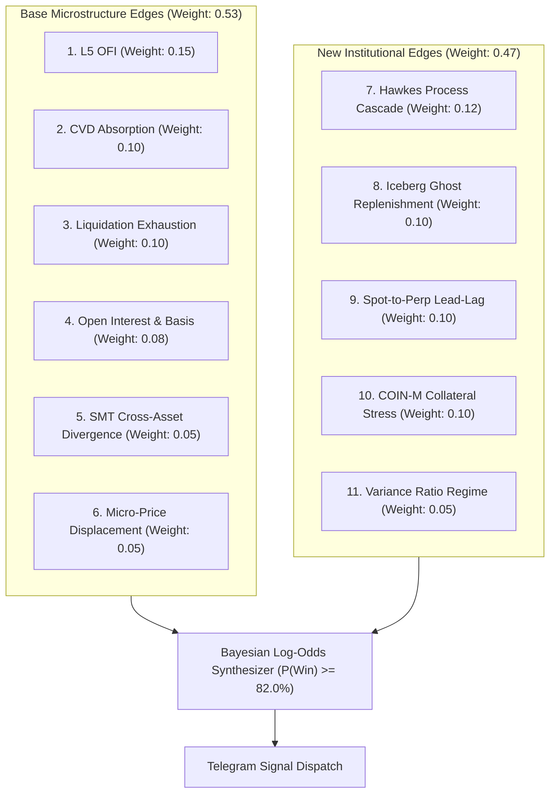

# 🧠 02. The 11 Institutional Alpha Edges Explained

> **Target:** Prottek trader jara technical analysis-er superficial chart theke beriye **market order flow physics** shikhte chay.  
> **Language:** Benglish (Bengali explanation + English quantitative trading terms).

---

## 1. Overview: 11-Edge Architecture

Amader signal bot 11-ti independent order flow microstructure edge combine kore Bayesian probability score $P(\text{Win})$ calculate kore. Prottek edge-er ekta distinct mathematical foundation ache:

---

## 2. Base Microstructure Edges (Phase 2 & 3)

### Edge 1: Level-5 Order Flow Imbalance (L5 OFI)
- **Weight:** `0.15` | **Activation Threshold:** $|Z| \ge 2.2$
- **Ki bhabe kaj kore?**
  Order book-er top 5 levels (Best Bid theke Bid 5, ebong Best Ask theke Ask 5)-e prottek 100 millisecond-e ki poriman limit orders add hocche ba cancel hocche seta mapar poddhoti holo OFI.
  Shudhu best level dekhle hobe na, karon spoofing hoy. Amra exponential depth decay bebohar kori:
  $$w_i = \exp(-0.25 \times (i - 1)) \quad \text{for } i \in [1, 5]$$
  Jodi bid side-e massive limit order joma hoy ebong ask side-e order delete hoy, tahole OFI highly positive hoy, ja price push-er agei amader janay.

### Edge 2: Cumulative Volume Delta (CVD) Absorption
- **Weight:** `0.10` | **Activation Threshold:** $|Z| \ge 2.0$
- **Ki bhabe kaj kore?**
  Eta institutional **"Limit Order Sponge"** dhorar poddhoti.
  Dhoro market-e aggressive sellers-ra 500 BTC market sell order dilo (CVD plunge korlo). Kintu price matro 2 dollar pore thik theme gelo!
  Keno? Karon ekjon boro buyer limit bid order pete boshe ache ebong shob sell order gile feleche (absorbed). Erpor aggressive seller-ra sesh holei price rocket-er moto blast kore opore uthbe.

### Edge 3: Liquidation Cascade Exhaustion ($Z_{\text{liq}}$)
- **Weight:** `0.10` | **Activation Threshold:** $Z \ge 3.0$
- **Ki bhabe kaj kore?**
  Crypto futures market retail trader-der liquidation-e chole. Jokhon boro flush hoy, exchange `!forceOrder@arr` market order pathiye accounts liquidate kore.
  Amra liquidation velocity track kori:
  $$v_{\text{liq}} = \frac{\Delta \text{Liquidation Volume}}{\Delta t}$$
  Jokhon liquidation velocity 3.0 standard deviation-er opore uthe tarpor drop kora shuru kore, tar mane forced selling sesh (Exhaustion). Etai institutional bottom-catch point.

### Edge 4: Open Interest (OI) & Basis Delta
- **Weight:** `0.08` | **Activation Threshold:** $|Z| \ge 1.8$
- **Ki bhabe kaj kore?**
  REST API call kore 5-minute interval-e Open Interest change ebong futures basis bps mapa hoy.
  - Price uthche + OI barche = Fresh institutional buying (Long expansion).
  - Price uthche + OI komche = Short covering rally (Weak move, trap).
  - Basis spread delta amader janay institutional arbitrageurs-ra basis compress korche kina.

### Edge 5: Cross-Asset Smart Money Divergence (SMT)
- **Weight:** `0.05` | **Activation Threshold:** $|Z| \ge 1.8$
- **Ki bhabe kaj kore?**
  Bitcoin, Ethereum, ebong Solana ekshonge move kore. Kintu reversal-er shomoy correlation bhenge jay.
  - **Bullish SMT:** Bitcoin ager swing low bhenge new lower-low dilo, kintu Ethereum ba Solana higher-low hold korlo! Er mane institutional buyers-ra Ethereum/Solana-te ager theke aggressive buy order pete boshe ache.
  - Reversal confirm howar eta shobcheye reliable lead indicator.

### Edge 6: Micro-Price Displacement
- **Weight:** `0.05` | **Activation Threshold:** $|Z| \ge 1.5$
- **Ki bhabe kaj kore?**
  Traditional mid-price holo $(P_{\text{bid}} + P_{\text{ask}}) / 2$. Eta khub dumb karon eta volume dekhe na.
  Micro-price order book-er bid ebong ask quantity die weighted hoy:
  $$P_{\text{micro}} = \frac{P_{\text{bid}} \cdot Q_{\text{ask}} + P_{\text{ask}} \cdot Q_{\text{bid}}}{Q_{\text{bid}} + Q_{\text{ask}}}$$
  Jodi Bid-e 100 BTC thake ar Ask-e matro 5 BTC thake, Micro-price instantly ask price-er dike shift hoye jay, tick trade execute howar agei!

---

## 3. The 5 Advanced Institutional Edges (Phase 6B)

### Edge 7: Self-Exciting Hawkes Process ($\lambda_t$)
- **Weight:** `0.12` | **Activation Threshold:** $Z \ge 2.5$
- **Ki bhabe kaj kore?**
  Earthquake seismology-te bebohar kora Hawkes Process amra crypto market-e forced liquidation cascade dhorar jonno use kori.
  Ekta liquidation jokhon trigger hoy, seta price-ke aro down push kore, ja arekjon trader-er stop loss hit koray (aftershock).
  Intensity formula:
  $$\lambda_t = \mu_0 + \sum_{t_k < t} \alpha \cdot \frac{V_k}{\bar{V}} \exp(-\beta(t - t_k))$$
  - $\mu_0 = 0.05$ (baseline rate)
  - $\alpha = 0.85$ (self-excitation factor)
  - $\beta = 1.20$ (decay rate)
- **Exhaustion Trigger:** Jokhon peak intensity baseline-er 25 gun barar por 30% decay kore:
  $$\frac{\text{Peak } \lambda}{\mu_0} \ge 25.0 \quad \text{and} \quad \lambda_t \le 0.70 \times \text{Peak } \lambda$$
  Ekhane cascade sompurno sesh, ar kono seller baki nei!

### Edge 8: Iceberg / Ghost Liquidity Replenishment ($G_t$)
- **Weight:** `0.10` | **Activation Threshold:** $Z \ge 2.0$
- **Ki bhabe kaj kore?**
  Whale trader-ra jokhon 1000 BTC sell ba buy korte chay, tara order book-e shob show kore na. Tara **Iceberg Orders** lagay — baire dekha jay matro 5 BTC, kintu pichone 995 BTC lukano thake.
  Amra aggTrade volume-er shathe depth20 visible drop compare kori:
  $$\text{Visible Drop} = \max(0, Q_{\text{prev}} - Q_{\text{new}})$$
  $$\text{Ghost Volume} = \max(0, \text{Aggressive Volume} - \text{Visible Drop})$$
  $$G_t = \frac{\sum \text{Ghost Volume}}{\sum \text{Executed Volume} + 10^{-9}}$$
- **Trigger:** Jokhon 30-second aggressive volume $> 2.0\sigma$ ebong $G_t \ge 0.68$, tar mane aggressive order-er 68%-er beshi lukano iceberg absorption chilo!

### Edge 9: Spot-to-Perp Microsecond Lead-Lag ($\Lambda_{\text{lead}}$)
- **Weight:** `0.10` | **Activation Threshold:** $|Z| \ge 2.5$
- **Ki bhabe kaj kore?**
  Perpetual futures-e leverage thakay retail trader-ra perp-e trade kore, kintu institutional spot ETF ebong treasury desk-ra **Real Spot Market**-e trade kore.
  Spot market-e kono funding rate ba liquidation cascade nei, tai Spot flow shob shomoy Perp flow-er 2 theke 15 millisecond age move kore.
  Formula:
  $$\Lambda_{\text{lead}} = Z(\text{Spot CVD}_{10s}) - 0.65 \cdot Z(\text{Perp CVD}_{10s}) - 0.80 \cdot \text{sign}(\text{Spot CVD}) \cdot Z(\Delta \text{Basis bps})$$
- **Trigger:** Jokhon Spot CVD aggressively lead korche kintu futures trader-ra akhono follow koreni, bot perp market-e front-run trade khule fele!

### Edge 10: Cross-Margined Collateral Stress ($\Psi_{\text{stress}}$)
- **Weight:** `0.10` | **Activation Threshold:** $|Z| \ge 2.0$
- **Ki bhabe kaj kore?**
  Binance-e du dhoroner futures ache:
  1. **USD-M Futures:** USDT/USDC die collateral deoya.
  2. **COIN-M Futures:** Nijeder Bitcoin ba Ethereum collateral rekhe trade kora (Crypto-margined).
  Crypto miners ebong institutional funds-ra COIN-M bebohar kore hedge korar jonno. Jokhon market crash kore, miner-der collateral-er value kome jay, ja COIN-M market-e massive liquidation cascade create kore.
  Formula:
  $$\Psi_{\text{stress}} = Z(\text{MicroPrice}_{\text{COIN-M}}) - Z(\text{MicroPrice}_{\text{USD-M}})$$
- **Trigger Short:** Jokhon USD-M retail rally korche kintu COIN-M miners-ra collateral stress-e heavily sell korche ($\Psi_{\text{stress}} \le -2.7$).
- **Trigger Long Bottom:** Jokhon COIN-M liquidation cascade sesh hoye rebound kore ($\Psi_{\text{stress}} \ge 1.6$).

### Edge 11: Lo-MacKinlay Variance Ratio & GKYZ Volatility ($VR_5$)
- **Weight:** `0.05` | **Activation Threshold:** $|Z| \ge 1.5$
- **Ki bhabe kaj kore?**
  Random Walk Hypothesis test kore Lo-MacKinlay Variance Ratio:
  $$VR(5) = \frac{\text{Var}(r_t(5))}{5 \cdot \text{Var}(r_t(1))}$$
  - $VR \approx 1.0$: Market pure random walk (noise, kono directional edge nei).
  - $VR \ge 1.18$: Market strongly **Trending / Breakout** (momentum strategy active).
  - $VR \le 0.85$: Market strongly **Mean-Reverting** (range-bound absorption strategy active).
  Shudhu close price noy, amra Garman-Klass-Yang-Zhang (GKYZ) extreme volatility combine kore Carry Skew calculate kori:
  $$\text{Carry Skew} = \frac{\text{Funding Rate}}{\sqrt{\sum \text{GKYZ Variance}} + 10^{-9}}$$
  Eta amader bole dey market momentum breakout-e ache naki mean-reversion range-e.

---

## 4. Bayesian Synthesis (How They Combine)

Shob 11-ti edge-er Z-score calculate korar por, bot Bayesian log-odds formula die composite score ber kore:

$$L_t = \beta_0 + \sum_{k=1}^{11} w_k \cdot \text{clip}(Z_k, -4.0, +4.0)$$
- Intercept: $\beta_0 = -1.8$ (conservative institutional prior)
- Activation condition:
  $$P(\text{Win}) = \frac{1}{1 + \exp(-L_t)} \ge 0.820 \quad (82.0\%)$$
  AND at least **4 distinct edges** must exceed their activation thresholds.
  AND all **vetoes must be cleared (0 active)**.

Ei strict requirements-er karon: **No low-probability gambles. Only highest conviction institutional setups.**
