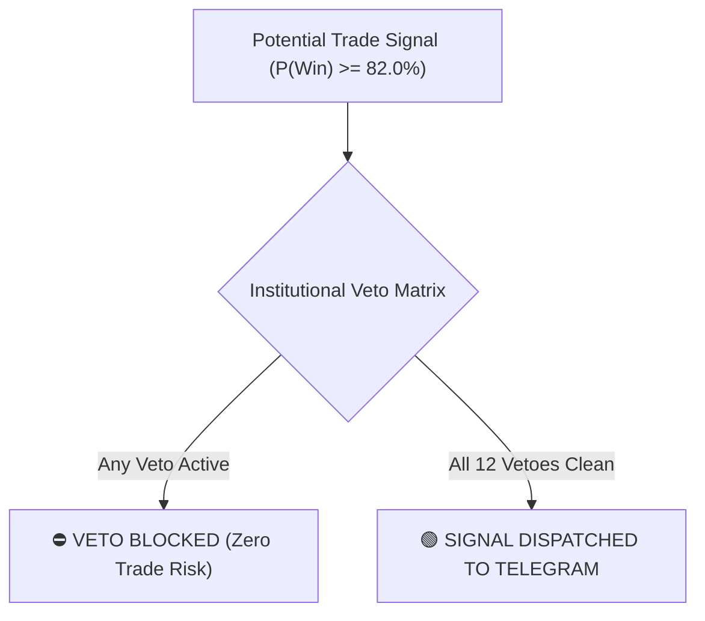

# 🛡️ 03. The Institutional Veto Matrix Explained

> **Philosophy:** Ekta bhalo trading system-er safolyo shudhu entry signals-e thake na, borong **kothay trade na kora uchit** seta janate thake.  
> **Language:** Benglish (Bengali + English Market Microstructure).

---

## 1. Why We Veto Trades (Ken Trade Korte Mana Kori?)

Retail trading bot-ra shob shomoy indicator cross holei buy ba sell kore fele. Tarpor market jokhon news spike, exchange matching glitch, ba market maker spoofing-e pore, retail account liquidate hoye jay.

Amader bot-e ache **12-ti Active Institutional Veto Guards**. Jodi 11-ti edge-er moddhe 10-ti edge-o buy bolte thake kintu **matro 1-ti veto active hoy**, bot shonge shonge signal block kore debe!

Capital preservation shobcheye boro prioritay.

---

## 2. Comprehensive Breakdown of All Vetoes

### 1. Spoofing Quote-Flicker Veto
- **Problem:** Market makers ba algorithmic manipulators-ra order book-e fake 500 BTC bid order rakhe jate retail buyers-ra bhabe boro support ache. Price ashar microsecond age tara order cancel kore dey (Quote Flicker).
- **Rule:** Jokhon amra depth update-e boro order dekhi kintu seta 500 millisecond (ba 5 consecutive depth frames)-er agei cancel hoye jay, bot spoofing detect kore ebong **30 seconds-er jonno signal veto kore**.

### 2. Flash-Crash Knife-Catch Veto
- **Problem:** Jokhon market vertical cascade-e pore, retail trader-ra "falling knife catch" korte giye buy kore ebong bar bar stop loss hit khay.
- **Rule:** Jodi liquidation velocity accelerating thake:
  $$\frac{d(v_{\text{liq}})}{dt} > 0$$
  bot kono counter-trend Long signal allow korbe na. Totokkhon porjonto wait korbe jotokkhon na liquidation deceleration ebong exhaustion confirm hoy.

### 3. Deleveraging Cascade Veto
- **Problem:** Boro exchange-e jokhon Auto-Deleveraging (ADL) ba massive multi-account long liquidation shuru hoy, spot price futures price-er theke boro discount-e chole jay.
- **Rule:** Jodi price drop kore ebong ekshonge Open Interest (OI) sharply collapse kore (leverage unravelling), kono mean-reversion long trade allow kora hobe na, unless $Z_{\text{liq}} > 3.5$ exhaustion override trigger hoy.

### 4. Funding Settlement Boundary Veto
- **Problem:** Binance 8 ghonta por por (00:00, 08:00, 16:00 UTC) funding fee collect kore. Settlement-er 15 minute age market maker-ra extreme funding avoidance arbitrage kore, jar fole artificial volatility hoy.
- **Rule:** Settlement-er 15-minute window $[T_{\text{funding}} - 15\text{m}, T_{\text{funding}}]$ er moddhe:
  - Jodi funding rate extreme positive hoy ($> +0.03\%$), kono Long signal allow hobe na (karon long-ke high fee dite hobe).
  - Jodi funding rate extreme negative hoy ($< -0.03\%$), kono Short signal allow hobe na.

### 5. Order Book Liquidity Vacuum Veto
- **Problem:** Flash crash ba illiquid hours-e order book-er limit orders shukanor moto empty hoye jay (Liquidity Vacuum). Ete bid-ask spread blowout hoy ebong slippage massive hoy.
- **Rule:**
  - Jodi Bid-Ask Spread $> 4.5\text{ bps}$ hoy, VETO.
  - Jodi top-5 depth notional historical rolling median-er 25%-er niche neme jay, VETO.

### 6. Macroeconomic Calendar Blackout Filter
- **Problem:** US Federal Reserve CPI, FOMC, NFP, ba Interest Rate decisions-er shomoy algorithms order book cancel kore dey ebong 500-pip wild wicks toiri hoy.
- **Rule:** ForexFactory high-impact USD events track kora hoy. Event time-er **15 minute age theke 15 minute por porjonto $[T_{\text{news}} - 15\text{m}, T_{\text{news}} + 15\text{m}]$ shob trade sompurno block**.

### 7. Real-Time Crypto RSS Headline Shock Veto
- **Problem:** US SEC lawsuits, exchange hack, ba stablecoin de-peg er moto unexpected breaking news instant panic sell create kore.
- **Rule:** Cointelegraph, CoinDesk, ebong Decrypt RSS feeds real-time scan hoy. Keywords jemon `"SEC"`, `"Lawsuit"`, `"Hack"`, `"Exploit"`, `"Freeze"`, `"Subpoena"` pawa matro **10 minute-er emergency trading lock** active hoye jay.

### 8. Deribit Options Gamma Unwind Veto (DVOL)
- **Problem:** Deribit crypto options market-er 85% volume control kore. Jokhon Deribit Volatility Index (DVOL) 3-minute-e $> 3.5\%$ spike kore, er mane institutional market maker-ra short gamma trapped hoye spot hedge korche. Ete wild directional cascades hoy.
- **Rule:** Deribit WebSocket (`deribit_volatility_index.btc_usd`) live track kora hoy. DVOL 3-minute ROC $> +3.5\%$ hole bot **10 minute-er gamma unwind veto** lagay.

### 9. US Spot ETF AP Window Veto
- **Problem:** US Spot Bitcoin ebong Ethereum ETF-er Authorized Participants (APs) daily rebalancing kore 15:45 theke 16:15 New York Time (ET). Ete high-frequency arbitrage algorithms market hijack kore.
- **Rule:**
  - Summer (US DST): 19:45 - 20:15 UTC.
  - Winter (Standard): 20:45 - 21:15 UTC.
  - Ei 30-minute window-te shob breakout trades blocked, unless $Z_{\text{liq}} > 3.5$ climax exhaustion ache.

### 10. Matching-Engine Jitter (E - T) Veto
- **Problem:** Jokhon Binance matching engine-e high traffic-er jonno queuing delay hoy, trade execute howar shomoy ($T$) ebong WebSocket frame dispatch howar shomoy ($E$)-er moddhe latency spike kore ($E - T > 35\text{ms}$). Ei stale data die trade korle slippage-e loss hobe.
- **Rule:** Jodi rolling average $(E - T) > 35\text{ms}$ hoy, instant veto! Unlock hote gele at least **20 consecutive frames** $\le 10\text{ms}$ low latency hote hobe (Hysteresis state machine).

### 11. DefiLlama Stablecoin Flow Veto
- **Problem:** Ekta Layer-1 chain-er (Sui, Solana, Avalanche, Near, TON) token price barleo jodi chain theke USDT/USDC drain hoye jay (capital outflow), seta ekta exit liquidity trap.
- **Rule:** DefiLlama REST API theke prottek chain-er 24-hour stablecoin supply delta mapa hoy. Jodi 24h change $\le -1.5\%$ hoy, oi chain-er native token-er (e.g. SUIUSDT, SOLUSDT) **shob Long breakout signals veto**.

### 12. Spectral Risk Portfolio Heat Gate
- **Problem:** Jokhon market-er shob crypto coin eksathe 0.9 correlation-e crash kore (systemic contagion), alada alada 5-ta coin-e Long thaka mane 5 gun boro loss!
- **Rule:** Spectral Absorption Ratio $AR \ge 0.72$ hole bot breakout signals block kore dey ebong portfolio heat cap 4 theke 1-e nambie aane.

---

## 3. Summary Checklist

Telegram-e `/vetoes` command dile tumi dekhte pabe kon kon vetoes ekhon active ebong kon kon vetoes clear. Jodi overall status **`CLEARED (0 Active)`** thake, tokhon-i bot valid signal generate korbe!
