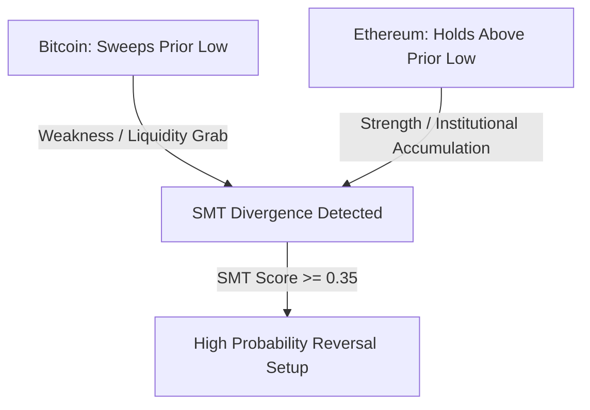

# Phase 3: Lazy REST Confirmation & Cross-Asset Regime Engine 🌐

High-Frequency Trading-e continuous REST API call kora ekta boro bhul. Binance-e 1 minute-e max 2400 weight limit thake. Beshi call korle IP ban kheye jabe!

Tai Phase 3-er concept holo: **Lazy On-Demand Confirmation**. Mane amra shob shomoy API call kori na; shudhu jokhon WebSocket-er local microstructure trigger fire kore, tokhon targeted confirmation neoar jonno REST query kora hoy.

---

## 1. `LazyRestConfirmedEngine` & 180-Second Caching

Amader REST engine matro duto critical endpoint query kore:
1. **Open Interest History (`/futures/data/openInterestHist?period=5m&limit=4`):**
   Futures market-e notun capital dhukche naki beriye jacche ta janar jonno.
2. **Premium Index (`/fapi/v1/premiumIndex`):**
   Perp mark price, spot index price, 8-hour funding rate, ebong next settlement time janar jonno.

### Defense Against Rate Limits:
- **`X-MBX-USED-WEIGHT-1M` Guard:** Prottek HTTP response theke used weight read kora hoy. Jodi used weight **$> 1800$** hoye jay (safe buffer below 2400), engine shob external request stop kore dey ebong fallback `(0.0, 0.0, 0.0)` return kore jate IP ban na hoy!
- **180-Second Disk/RAM Cache:** Prottek symbol-er data 180 seconds (3 minutes) cache kora thake. Ei shomoyer moddhe jotobar-i signal trigger hok na keno, zero network call hoy!

### Math Calculations:
$$\Delta OI\% = \left(\frac{OI_{\text{now}} - OI_{3\_\text{periods\_ago}}}{OI_{3\_\text{periods\_ago}}}\right) \times 100$$
$$\text{Basis (bps)} = \left(\frac{P_{\text{mark}} - P_{\text{index}}}{P_{\text{index}}}\right) \times 10^4$$

---

## 2. Cross-Asset Smart Money Divergence (SMT)

### SMT Ki?
Correlated assets (jemon Bitcoin ebong Ethereum) shobshomoy eksathe move korar kotha. Kintu institutional players-ra jokhon ekta asset-e position accumulate kore, tokhon **structural divergence** toiri hoy.

### Bullish SMT Formula:
Dhoro Asset A (Bitcoin) tar purono swing low bhenge niche sweep korlo ($P_{A,t} < L_A(t_0)$).
Kintu Asset B (Ethereum) tar purono swing low bhenge na, borong shokto bhabe low-er upore hold korlo ($P_{B,t} > L_B(t_0)$)!

Etar mane holo: **Ethereum-e institutional buying pressure eto beshi je seller-ra take niche namate parchhe na!**

$$\text{SMT} = \left(\frac{P_{B,t} - L_B(t_0)}{\text{ATR}_B}\right) - \left(\frac{P_{A,t} - L_A(t_0)}{\text{ATR}_A}\right)$$

Jokhon **$\text{SMT} \ge 0.35$**, tokhon system Bullish SMT trigger kore!

---

## 3. Derivatives Positioning & Regime Classifier

Open interest, basis, ebong funding rate diye market-er institutional setup bojha jay:

| Setup Name | Price Action | OI Delta | Basis (bps) | Funding Rate | Meaning |
| :--- | :--- | :--- | :--- | :--- | :--- |
| **Short Squeeze** | Flat ba Falling | $> +1.5\%$ | $< -4.0$ (Backwardation) | $< -0.01\%$ (Negative) | Seller-ra over-leveraged short nichhe, market maker ra upore squeeze korbe! |
| **Long Trap** | Spiking to Resistance | $> +2.0\%$ | $> +8.0$ (Contango) | $> +0.03\%$ (Overheated) | Retail FOMO long-e phashche, price dump korbe! |
| **Neutral** | Any | Normal | Normal | Normal | Kono extreme positioning nei. |

---

## 4. Phase 3 Vetoes

### A. Deleveraging Veto (`DeleveragingVeto`):
Jodi 15 minute-e price drop kore ebong sathe Open Interest-o contract kore ($\Delta OI\% < -2.5\%$) ebong funding neutral thake, tar mane eita kono fresh short selling na — borong **organic long deleveraging (position closing)**.
- Ekhane mean-reversion long dhora dangerous, tai bot LONG veto kore.
- **Exception:** Jodi $Z_{\text{liq}} > 3.5$ hoy (massive capitulation exhaustion), tokhon veto override hoye signal allow hoy.

### B. Funding Settlement Boundary Veto (`FundingSettlementBoundaryVeto`):
Futures market-e prottek 8 ghontay funding fee settle hoy.
- Jodi tumi Long thako ebong funding rate extreme positive hoy ($> +0.05\%$), settlement-er shomoy tomake prochur fee dite hobe!
- Tai settlement time-er **$\pm 5$ minutes**-er moddhe emon kono trade allow kora hoy na ja heavy funding penalty dite baddho kore.
